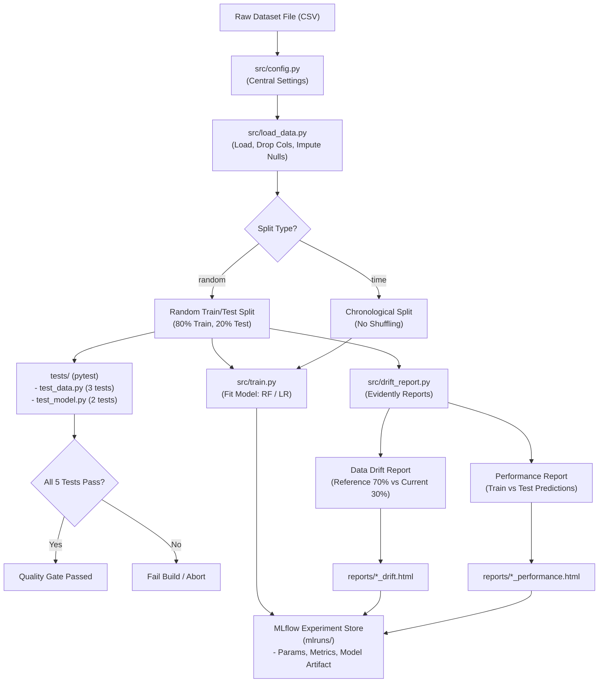
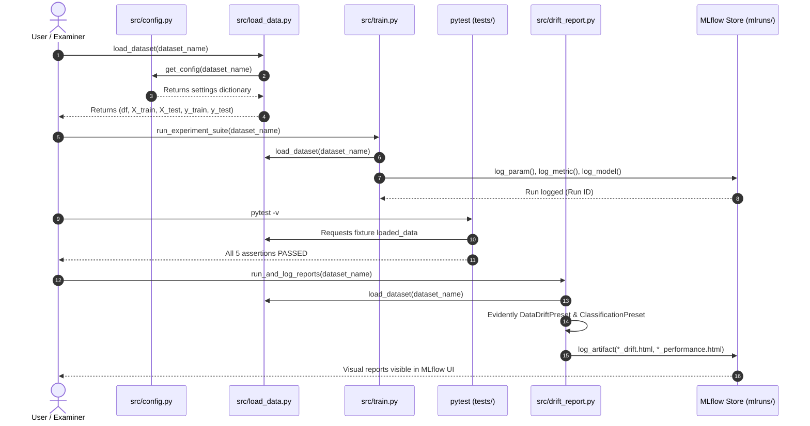

# Data Flow Architecture Guide

This document explains end-to-end how data flows through the **ml_devops_poe** project, from raw CSV ingestion to automated testing, MLflow tracking, and Evidently drift monitoring.

---

## 1. Plain-English Step-by-Step Walkthrough

1. **Raw File Ingestion**:
   - The raw CSV dataset is read from disk (`data/irish/Iris.csv` or `data/domain/heart_disease.csv`).
   - The path, target column name, drop columns, and task type are retrieved strictly from `src/config.py`.

2. **Cleaning & Missing Value Imputation**:
   - Any identifier or extraneous columns specified in `config.py` (such as `Id`) are dropped.
   - Missing values are inspected: numerical columns are filled with their median value; categorical columns are filled with their mode.

3. **Train-Test Splitting**:
   - If `split_type="random"`, standard stratified random splitting is performed (`test_size=0.2`, `random_state=42`).
   - If `split_type="time"`, the dataset is partitioned chronologically without shuffling, preventing lookahead bias on temporal sequences.

4. **Model Training & Inference**:
   - A scikit-learn model (`RandomForestClassifier`, `LogisticRegression`, etc.) is fitted on the training split `(X_train, y_train)`.
   - Predictions `y_pred` are generated for `X_test`.

5. **MLflow Experiment Tracking**:
   - Training runs are grouped under the experiment name defined in `config.py`.
   - MLflow logs hyperparameters (depth, estimators, C), evaluation metrics (Accuracy, F1, RMSE), and the serialized model artifact alongside an input sample and schema signature.

6. **Automated Testing with pytest**:
   - Automated pytest fixtures load the clean splits and run 5 test assertions: verifying zero null values in target, verifying column presence, ensuring strictly disjoint train-test indices, and confirming the model's accuracy beats a naive majority-class baseline.

7. **Evidently Data Drift & Performance Analysis**:
   - **Data Drift**: Training data is divided into a reference baseline (first 70%) and a current observation window (last 30%). Two-sample Kolmogorov-Smirnov tests assess per-column distribution drift.
   - **Model Performance**: Evaluates predictions on reference (training) vs current (testing) splits.
   - HTML reports are saved locally to `reports/` and uploaded as artifacts into MLflow.

---

## 2. Mermaid Flowchart of Full Pipeline



---

## 3. ASCII Flow Diagram (Text Editor Friendly)

```
+-------------------------------------------------------------------------+
|                         RAW DATASET FILE (.csv)                         |
+-------------------------------------------------------------------------+
                                    |
                                    v
+-------------------------------------------------------------------------+
|                  CENTRAL CONFIGURATION (src/config.py)                  |
|    - File path, target column, task type, split type, drop columns      |
+-------------------------------------------------------------------------+
                                    |
                                    v
+-------------------------------------------------------------------------+
|                 LOAD & PREPROCESS (src/load_data.py)                    |
|    - Drop unwanted columns (e.g. Id)                                    |
|    - Impute missing values (median/mode)                                |
|    - Split: Random (classification) OR Time-series (chronological)      |
+-------------------------------------------------------------------------+
         |                                  |                    |
         v                                  v                    v
+-------------------+             +------------------+   +----------------+
|  MODEL TRAINING   |             |   PYTEST SUITE   |   |   EVIDENTLY    |
|   (src/train.py)  |             |     (tests/)     |   | (drift_report) |
+-------------------+             +------------------+   +----------------+
         |                                  |                    |
         | Model fit & evaluation           | 5 Quality gates    | 70/30 Split
         v                                  v                    v
+-------------------+             +------------------+   +----------------+
| MLFLOW TRACKING   |             | Pass / Fail      |   | HTML Reports   |
| - Params          |             | - Zero nulls     |   | - Drift HTML   |
| - Metrics (Acc/F1)|             | - Column check   |   | - Perf HTML    |
| - Model Artifact  |             | - Zero leakage   |   +----------------+
| - Report Artifacts|             | - Beat baseline  |           |
+-------------------+             +------------------+           |
         |                                                       |
         +<------------------------------------------------------+
         v
+-------------------------------------------------------------------------+
|                      MLFLOW USER INTERFACE (Web UI)                     |
|           Runs, Metrics Comparison, Artifacts, and HTML Reports         |
+-------------------------------------------------------------------------+
```

---

## 4. Mermaid Sequence Diagram



---

## 5. File Responsibilities, Inputs & Outputs

| File | Primary Responsibility | Input(s) | Output / Returns |
| :--- | :--- | :--- | :--- |
| `src/config.py` | Central configuration dictionary | Dataset key name (`'irish'`, `'domain'`) | Configuration dictionary (`dict`) |
| `src/load_data.py` | Reading, cleaning, imputing, splitting | Dataset key name (`str`) | `(df, X_train, X_test, y_train, y_test)` |
| `src/train.py` | Multi-run training & MLflow logging | Dataset name, model type, hyperparams | MLflow `run_id` (`str`), logs artifacts |
| `src/drift_report.py` | Drift & performance reporting | Dataset key name (`str`) | `(drift_html, perf_html)` logged to MLflow |
| `tests/conftest.py` | Shared test fixtures | Pytest test runner | Fixture objects (`loaded_data`, `trained_model`) |
| `tests/test_data.py` | Data integrity validation | Pytest fixtures | Boolean assertions (Zero nulls, column match) |
| `tests/test_model.py` | Inference & accuracy validation | Pytest fixtures | Boolean assertions (Length match, beats baseline) |

---

## 6. Output Storage Destinations

- **HTML Reports**: Saved to `ml_devops_poe/reports/` (`*_drift.html`, `*_performance.html`).
- **MLflow Tracking & Models**: Saved locally in `ml_devops_poe/mlruns/` (SQLite / file store with parameters, metrics, model artifacts, and copies of Evidently HTML files).
- **Console Terminal**: Displays inspection shapes, evaluation metrics, pytest pass/fail summaries, and drift score tables.

