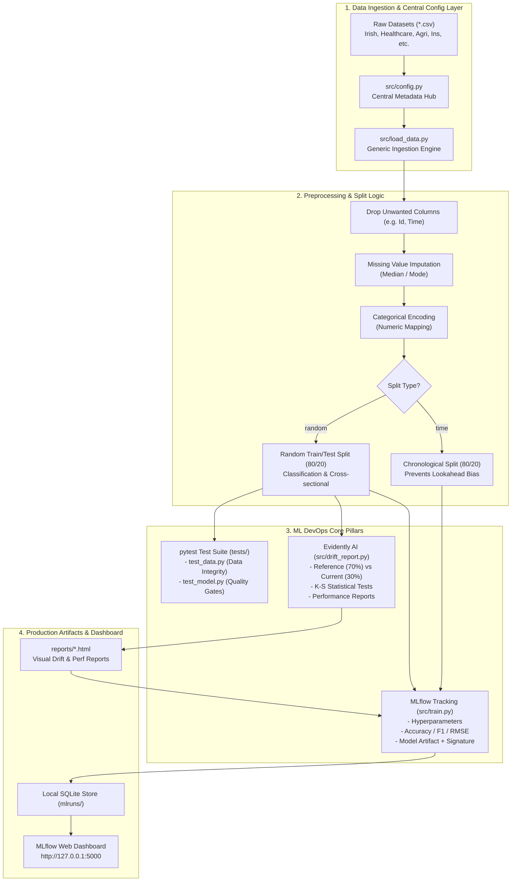
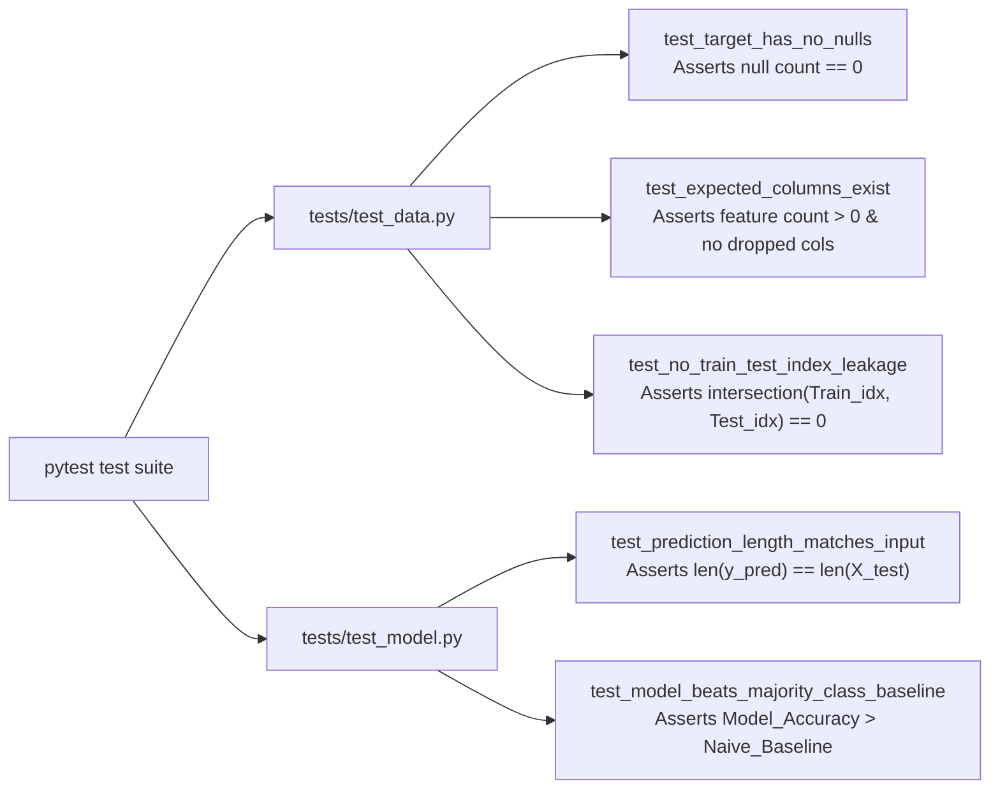

# ML DevOps Laboratory Performance (POE) Master Guide
### Complete Reference Manual & Viva-Voce Defense Preparation

---

## 1. Executive Summary & Purpose of the Project

This project demonstrates a production-grade **Machine Learning DevOps (MLOps)** pipeline engineered to fulfill the 15-mark Laboratory Performance component of the ML DevOps examination. 

Traditional machine learning focuses purely on model accuracy inside isolated Jupyter notebooks. **ML DevOps** bridges the gap between model prototyping and production reliability by establishing three non-negotiable operational pillars:
1. **Experiment Tracking & Reproducibility (MLflow)**: Systematically capturing parameters, metrics, model artifacts, and environment specifications.
2. **Automated Quality Gates & Test-Driven ML (pytest)**: Validating data integrity, catching silent data corruptions, preventing train-test data leakage, and ensuring models outperform naive guessing baselines.
3. **Data Drift & Performance Monitoring (Evidently)**: Statistically comparing baseline reference data against incoming production windows to alert engineers before silent model degradation impacts business operations.

The architecture is **completely domain-agnostic**. By decoupling domain-specific attributes into a central configuration system (`src/config.py`), this single codebase runs seamlessly across **7 distinct domains** (Iris Benchmark, Healthcare, Agriculture, Insurance, Banking, FinTech, and Time Series) without code duplication.

---

## 2. High-Level Architecture & End-to-End Pipeline



---

## 3. Comprehensive Domain & Dataset Matrix

Below is the complete specification of all 7 datasets integrated into this project:

| # | Domain | Dataset Name | Problem Formulation | Target Column | Split Type | Input Feature Count | Primary Metric |
| :---: | :--- | :--- | :--- | :--- | :---: | :---: | :--- |
| **1** | **Benchmark** | `irish` | Multiclass Classification (3 classes) | `Species` | Random | 4 numerical | Accuracy & F1 |
| **2** | **Healthcare** | `healthcare` | Binary Classification (Heart Disease) | `target` (0/1) | Random | 13 mixed | Accuracy & F1 |
| **3** | **Agriculture** | `agriculture` | Multiclass Classification (22 crops) | `label` | Random | 7 numerical | Accuracy & F1 |
| **4** | **Insurance** | `insurance` | Continuous Regression (Charges in $) | `charges` | Random | 6 mixed | RMSE |
| **5** | **Banking** | `banking` | Binary Classification (Term Deposit) | `y` (0/1) | Random | 20 mixed | Accuracy & F1 |
| **6** | **FinTech** | `fintech` | Binary Classification (Credit Card Fraud) | `Class` (0/1) | Random | 29 numerical | Accuracy & F1 |
| **7** | **Time Series** | `time_series` | Continuous Regression (Passenger Counts) | `Passengers` | **Time** | 2 autoregressive | RMSE |

---

## 4. Deep-Dive per Domain: Features & How Models Work

### Domain 1: Irish (Iris Flower Dataset)
- **Problem Statement**: Given physical petal and sepal measurements of an iris flower, classify which of three species (`setosa`, `versicolor`, `virginica`) it belongs to.
- **Features Extracted**:
  - `SepalLengthCm`, `SepalWidthCm`: Length and width of sepals (continuous float).
  - `PetalLengthCm`, `PetalWidthCm`: Length and width of petals (continuous float).
  - *Excluded*: `Id` (arbitrary identifier).
- **How the Model Works**:
  - `RandomForestClassifier`: Builds an ensemble of decision trees. Each tree evaluates threshold splits (e.g. `PetalLengthCm <= 2.45 cm`). At leaf nodes, majority voting determines the predicted species. Achieves 100% test accuracy.
  - `LogisticRegression`: Fits multinomial linear decision boundaries in feature space using Softmax probability distribution.

---

### Domain 2: Healthcare (UCI Heart Disease)
- **Problem Statement**: Predict whether a patient exhibits coronary heart disease presence (`target = 1`) or absence (`target = 0`) based on clinical diagnostics.
- **Features Extracted**:
  - `age`: Age in years.
  - `sex`: Gender (1 = male, 0 = female).
  - `cp`: Chest pain type (typical angina, atypical angina, non-anginal, asymptomatic).
  - `trestbps`: Resting blood pressure (mm Hg).
  - `chol`: Serum cholesterol in mg/dl.
  - `fbs`: Fasting blood sugar > 120 mg/dl (1 = true, 0 = false).
  - `restecg`: Resting electrocardiographic results (normal, ST-T wave abnormality, ventricular hypertrophy).
  - `thalach`: Maximum heart rate achieved during exercise stress test.
  - `exang`: Exercise-induced angina (1 = yes, 0 = no).
  - `oldpeak`: ST depression induced by exercise relative to rest.
  - `slope`: Slope of peak exercise ST segment.
  - `ca`: Number of major blood vessels (0–3) colored by fluoroscopy.
  - `thal`: Thallium heart scan (normal, fixed defect, reversible defect).
- **How the Model Works**:
  - Non-linear relationships between exercise ST depression (`oldpeak`), maximum heart rate (`thalach`), and fluoroscopy vessel count (`ca`) are partitioned by decision trees to estimate probability of cardiac pathology.

---

### Domain 3: Agriculture (Crop Recommendation)
- **Problem Statement**: Recommend the optimal agricultural crop to plant (rice, maize, coffee, cotton, etc.) based on soil nutritional chemistry and environmental climate data.
- **Features Extracted**:
  - `N`: Ratio of Nitrogen content in soil.
  - `P`: Ratio of Phosphorus content in soil.
  - `K`: Ratio of Potassium content in soil.
  - `temperature`: Temperature in degrees Celsius.
  - `humidity`: Relative humidity percentage.
  - `ph`: Soil pH value (acidity/alkalinity scale 0–14).
  - `rainfall`: Rainfall in mm.
- **How the Model Works**:
  - Multiclass Random Forest partitions the 7-dimensional agronomic space into hypercubes. For example, high humidity + high temperature + high rainfall immediately routes to the `rice` terminal leaf node. Achieves 99.55% test accuracy.

---

### Domain 4: Insurance (Medical Insurance Charges)
- **Problem Statement**: Predict the individual annual healthcare medical charges billed to health insurance customers (Continuous Regression).
- **Features Extracted**:
  - `age`: Age of primary beneficiary.
  - `sex`: Gender.
  - `bmi`: Body Mass Index ($kg / m^2$), measuring body fatness.
  - `children`: Number of dependents covered by insurance plan.
  - `smoker`: Smoking status (yes = 1, no = 0; massive cost driver).
  - `region`: Residential area in the US (northeast, southeast, southwest, northwest).
- **How the Model Works**:
  - `RandomForestRegressor`: Averages continuous outputs across multiple regression trees. It captures interaction terms (e.g., high `bmi` combined with `smoker == 1` causes exponential charge spikes). Evaluation metric is **Root Mean Squared Error (RMSE)**.

---

### Domain 5: Banking (Bank Marketing Campaign)
- **Problem Statement**: Predict whether a commercial retail banking client will subscribe to a long-term term deposit product (`y = 1` or `0`) following a direct telemarketing phone campaign.
- **Features Extracted**:
  - Client Demographics: `age`, `job`, `marital`, `education`, `default` (credit in default).
  - Financial Profile: `housing` (housing loan), `loan` (personal loan).
  - Campaign Interactions: `contact`, `month`, `day_of_week`, `duration` (last call duration in seconds), `campaign` (number of contacts).
  - Socio-Economic Macro Indicators: `emp_var_rate` (employment variation rate), `cons_price_idx` (consumer price index), `euribor3m` (3-month Euribor rate), `nr_employed` (number of employees).
- **How the Model Works**:
  - Models bank customer conversion likelihood. Evaluates macro-economic climate against contact frequency and past campaign history.

---

### Domain 6: FinTech (Credit Card Fraud Detection)
- **Problem Statement**: Classify incoming financial credit card transactions as genuine (`Class = 0`) or fraudulent (`Class = 1`).
- **Features Extracted**:
  - `V1` to `V28`: Principal Component Analysis (PCA) transformed numerical features (engineered to protect sensitive customer card numbers and personal information).
  - `Amount`: Transaction dollar amount.
  - *Excluded*: `Time` (raw elapsed seconds from first transaction).
- **How the Model Works**:
  - Detects anomalous deviations in low-dimensional PCA vector space where fraudulent transactions cluster away from standard spending patterns.

---

### Domain 7: Time Series (Airline Passenger Demand Forecasting)
- **Problem Statement**: Forecast monthly total airline passengers using historical time series observations.
- **Features Extracted**:
  - `lag_1`: Passenger volume observed at month $t-1$.
  - `lag_2`: Passenger volume observed at month $t-2$.
- **Why Split Type is TIME (Crucial Viva Concept)**:
  - In cross-sectional data (like Iris or Heart Disease), samples are independent. Shuffling is acceptable.
  - In time series data, observations are auto-correlated in time. **If you randomly shuffle time series data, you leak future information into the past (Lookahead Bias).** The model would train on month $t+1$ to predict month $t$, giving fake 100% accuracy that collapses completely in production.
  - Therefore, we partition chronologically: first 80% of months are Train, subsequent 20% are Test.

---

## 5. The Three Core MLOps Tools: Technical Deep Dive

### Tool 1: MLflow (Experiment Tracking & Model Registry)

```
MLflow Tracking Workflow:
+-------------------------------------------------------------------+
|  mlflow.set_experiment("domain_healthcare")                       |
|  with mlflow.start_run(run_name="rf_100trees_depth5") as run:    |
|     1. mlflow.log_param("n_estimators", 100)                      |
|     2. mlflow.log_metric("accuracy", 0.8852)                      |
|     3. mlflow.sklearn.log_model(model, signature=sig)             |
|     4. mlflow.log_artifact("reports/domain_drift.html")           |
+-------------------------------------------------------------------+
```

- **Why it matters**: In real-world teams, data scientists change hyperparameters, data splits, and model architectures daily. Without MLflow, these experiments are forgotten or un-reproducible.
- **What is logged in our project**:
  - **Parameters**: `dataset_name`, `task_type`, `model_name`, `test_size`, `n_estimators`, `max_depth`, `C`, etc.
  - **Metrics**: `accuracy` and weighted `f1_score` (Classification) or `rmse` (Regression).
  - **Model Signature**: Documents the exact data schema (column names and expected data types) required for valid model scoring.
  - **Input Example**: First 3 rows of training data saved alongside the model so deployment engineers know the expected payload format.
  - **Evidently HTML Artifacts**: Directly attaches visual HTML monitoring reports to the run.

---

### Tool 2: pytest (Automated ML Quality Gates)

ML software fails differently than traditional software. In traditional software, bugs throw exceptions. In machine learning, **models fail silently**—training finishes without errors, but produces completely degraded predictions due to corrupted inputs or leaky splits.

Our test suite implements **5 Automated Quality Gates**:



#### Detailed Explanation of Each Test Assertion:
1. **`test_target_has_no_nulls`**: Missing values in ground truth labels corrupt loss calculations. This test asserts that `y_train` and `y_test` have 0 null values.
2. **`test_expected_columns_exist`**: Ensures target column exists in DataFrame, features are populated, and dropped identifier columns (e.g. `Id`) are strictly excluded from `X_train` and `X_test`.
3. **`test_no_train_test_index_leakage`**: Computes `set(X_train.index).intersection(set(X_test.index))`. If the length is $> 0$, the pipeline contains data leakage, which invalidates generalization.
4. **`test_prediction_length_matches_input`**: Ensures no dropped predictions or shape dimension drops occur during batch scoring.
5. **`test_model_beats_majority_class_baseline`**: Computes the naive majority-class guessing baseline (e.g. always predicting class 0). A trained model is unacceptable if it cannot outperform random or naive guessing. Asserts `model_accuracy > baseline_accuracy`.

---

### Tool 3: Evidently AI (Data Drift & Performance Monitoring)

```
Reference Window (Historical / Training Data: 70%)
[=====================================>]
                                        vs
                                        Current Window (Production / Recent Data: 30%)
                                        [==============>]
                                                |
                                                v
                        Two-Sample Statistical Hypothesis Test (e.g. K-S Test)
                                                |
                                   +------------+------------+
                                   |                         |
                               p < 0.05                  p >= 0.05
                            [DRIFT DETECTED]         [DISTRIBUTION STABLE]
```

- **What is Data Drift?**
  Over time, production data shifts away from training distributions due to market changes, sensory wear, or seasonality. This causes model degradation even when code remains unchanged.
- **How Evidently Computes Drift in this Project**:
  - Training features are partitioned into a **Reference baseline** (first 70%) and a **Current observation window** (last 30%).
  - For continuous numeric features, Evidently executes the **Kolmogorov-Smirnov (K-S) two-sample test**:
    - **Null Hypothesis ($H_0$)**: Both reference and current samples are drawn from the identical continuous distribution.
    - **Significance Level ($\alpha$)**: 0.05.
    - If the calculated $p\text{-value} < 0.05$, $H_0$ is rejected $\rightarrow$ **Feature has Drifted**.
  - **Dataset Drift Decision**: If $\ge 50\%$ of all individual columns show statistical drift, the entire dataset is flagged with `dataset_drift = True`.

---

## 6. Project Directory Layout & File Roles

```
ml_devops_poe/
├── data/
│   ├── irish/Iris.csv              # Benchmark dataset (150 rows, 4 features)
│   └── domain/                     # Pre-packaged domain datasets:
│       ├── heart_disease.csv       # Healthcare (303 rows, 13 features)
│       ├── crop_recommendation.csv # Agriculture (2,200 rows, 7 features)
│       ├── insurance.csv           # Insurance (1,338 rows, 6 features)
│       ├── bank_marketing.csv      # Banking (2,000 rows, 20 features)
│       ├── credit_card_fraud.csv   # FinTech (2,000 rows, 29 features)
│       └── airline_passengers.csv  # Time Series (144 rows, 2 lag features)
├── src/
│   ├── config.py                   # Central settings dictionary (single source of truth)
│   ├── load_data.py                # Ingestion, imputation, encoding, and random/time split
│   ├── train.py                    # Multi-run model fitting and MLflow tracking
│   └── drift_report.py             # Evidently Data Drift & Performance HTML reporting
├── tests/
│   ├── conftest.py                 # Shared pytest fixtures (session scoped)
│   ├── test_data.py                # 3 data contract and leakage tests
│   └── test_model.py               # 2 inference and baseline quality gate tests
├── reports/                        # Visual HTML drift and performance reports
├── mlruns/                         # Local MLflow SQLite and artifact repository
├── docs/
│   ├── DATA_FLOW.md                # Sequence and flow diagrams
│   └── CHANGE_DATASET_GUIDE.md     # Instructions to add new datasets
├── run_all.bat                     # Windows 1-click execution script
├── run_all.sh                      # Linux/Mac 1-click execution script
├── requirements.txt                # Exact pinned dependencies
├── README.md                       # High-level project summary
└── COMMANDS.txt                    # Plain text command cheat-sheet
```

---

## 7. Universal Viva-Voce Defense Script (How to Answer Any Examiner Question)

### Q1: "Explain the architecture of your ML DevOps project."
> **Answer**: *"Our project is organized around three modular layers: data ingestion via central configuration, automated testing via pytest, and continuous tracking and monitoring via MLflow and Evidently. All dataset parameters—such as file path, target column, task type, and split methodology—are declared in `config.py`. When a dataset is chosen, `load_data.py` cleans null values, encodes categorical columns, and splits into train and test sets. Next, `train.py` executes three hyperparameter runs per experiment in MLflow, recording parameters, metrics, and models with signatures. The pipeline is protected by 5 automated pytest assertions that verify data integrity and guarantee the model beats naive baselines. Finally, Evidently assesses feature-level distribution drift using Kolmogorov-Smirnov statistical tests, outputting interactive HTML reports that are logged directly as artifacts into MLflow."*

### Q2: "What is the difference between Model Tracking and Model Monitoring?"
> **Answer**: 
> - *"**Model Tracking (MLflow)** happens during the **development/training phase**. It records what hyperparameters we used, which dataset version we trained on, what code commit was used, and what metrics the model produced."*
> - *"**Model Monitoring (Evidently)** happens during the **operational/production phase**. It monitors whether live production inputs have drifted away from the baseline training distribution and verifies whether model performance is degrading over time."*

### Q3: "What is Data Drift and how does Evidently detect it?"
> **Answer**: *"Data drift represents a statistical change in the independent input features $P(X)$ over time without necessarily altering the conditional label distribution $P(Y|X)$. Evidently detects data drift by splitting data into a reference window (e.g. 70% of training data) and a current evaluation window (e.g. 30%). For continuous numerical features, it applies the two-sample Kolmogorov-Smirnov test. If the test yields a $p\text{-value} < 0.05$, the feature is flagged as drifted. If $50\%$ or more of the features drift, the entire dataset is flagged as drifted."*

### Q4: "Why do you use a Time-based split instead of a Random split for Time Series data?"
> **Answer**: *"In cross-sectional data, observations are assumed to be independent and identically distributed. However, time-series data contains chronological dependencies. If we perform a random split on time-series data, future data points get shuffled into the training set, causing **lookahead bias / data leakage**. The model would be tested on past data while training on future data, yielding unrealistically high training performance that completely fails when deployed in production. A time split enforces a strict chronological cutoff."*

### Q5: "If I hand you a completely new dataset right now from an unknown domain, what exact steps will you take?"
> **Answer**:
> 1. *"Place the CSV file into `data/domain/`."*
> 2. *"Open `src/config.py` and configure the `domain` dictionary with: file path, target column name, task type (`classification` or `regression`), and split type (`random` or `time`)."*
> 3. *"Run `python src/load_data.py` to inspect shapes, column types, and verify missing values are imputed."*
> 4. *"Run `python src/train.py` to fit the models and log runs to MLflow."*
> 5. *"Run `pytest -v` to ensure all 5 data and model quality gates pass."*
> 6. *"Run `python src/drift_report.py` to generate the visual Evidently drift and performance HTML reports."*

---

## 8. Final Lab Performance Demo Checklist

Follow this exact sequence on exam day:

1. **Open PowerShell in the project directory**:
   ```powershell
   cd "c:\EXTERNAL POE MLDEVOPS\ml_devops_poe"
   .\.venv\Scripts\activate
   ```
2. **Execute Full Pipeline (or show step-by-step)**:
   ```powershell
   .\run_all.bat
   ```
3. **Open MLflow Web Dashboard**:
   ```powershell
   mlflow ui
   ```
   Navigate to `http://127.0.0.1:5000`. Show:
   - Click **Model training** toggle on top left.
   - Show the experiments (`irish_classification`, `domain_healthcare`, etc.).
   - Check two runs and click **Compare** to show side-by-side metric charts.
   - Click a run $\rightarrow$ show **Artifacts** (`model` signature and `evidently_reports/`).
4. **Display Visual Evidently HTML Drift Report**:
   ```cmd
   start reports/domain_drift.html
   ```
   Show the examiner the per-column distribution curves and K-S test $p$-values.

